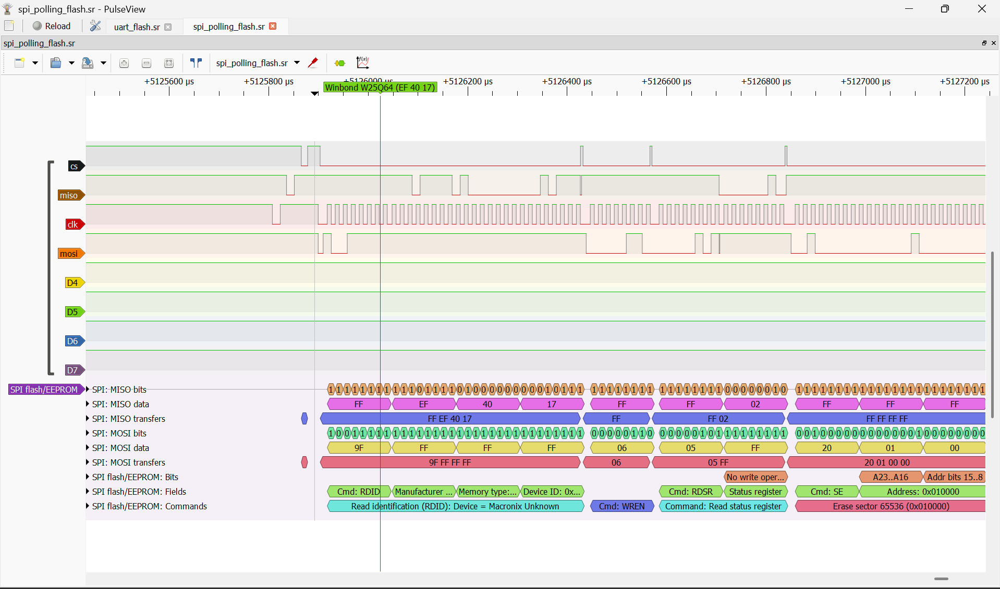
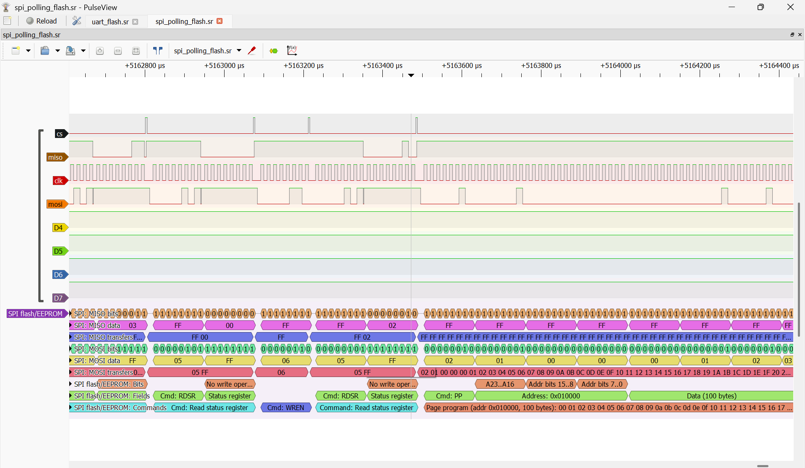
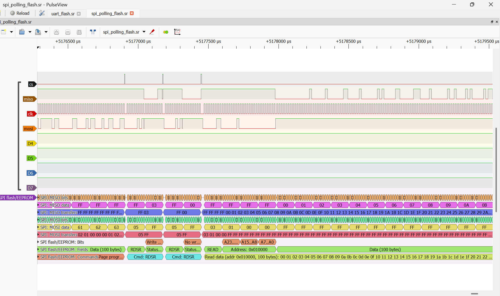
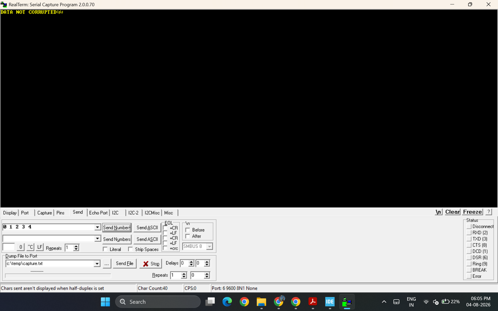
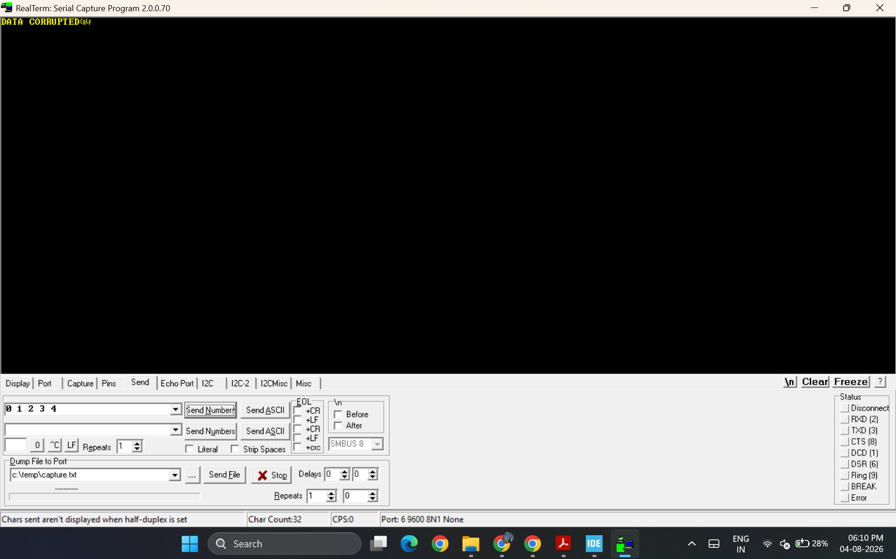

# Bare-Metal STM32F411 Peripheral Drivers

Register-level GPIO, SPI, USART and RCC drivers written from scratch for the
STM32F411E-DISCO — no HAL, no CubeMX, no generated code. The headline
application is an SPI NOR flash driver with a UART data path and read-back
verification.

## Repository Layout

```
drivers/Inc, drivers/Src   my drivers — GPIO, SPI, USART, RCC, W25Q64 flash, delay
Src/MAIN.c                 flash + UART application (the main project)
Src/00*.c, USART_DEMO.c    smaller exercises used while building the drivers
Startup/                   vendor startup file and vector table
drivers/csrc/              third party — u8g2 display library
drivers/lsm303agr-pid-*/   third party — ST accelerometer driver
```

Everything under `drivers/Inc`, `drivers/Src` and `Src` is my own code.
`drivers/csrc` and `drivers/lsm303agr-pid-*` are vendored third-party
libraries included so the project builds; they are used by a separate
RTOS application, not by the flash project.

Only one `main()` can be in the build at a time. The flash application is
`Src/MAIN.c`; the other files in `Src/` are excluded from the build in the
CubeIDE project settings.

---

# SPI NOR Flash Driver

## Hardware

- STM32F411E-DISCO
- W25Q64 SPI NOR flash (8 MB), breakout module
- USB-to-UART converter

The F411E-DISCO's ST-LINK has no virtual COM port, so an external USB-UART
adapter is required for the serial link.

## Pin Configuration

### SPI2 — MCU to Flash

| Pin  | Signal | Mode               | AF  |
|------|--------|--------------------|-----|
| PB13 | SCLK   | Alternate function | AF5 |
| PB14 | MISO   | Alternate function | AF5 |
| PB15 | MOSI   | Alternate function | AF5 |
| PB10 | CS     | GPIO output        | —   |

SPI mode 0, 8-bit, master, software NSS (SSM = 1, SSI = 1).
Prescaler DIV2 → 8 MHz SCLK from 16 MHz PCLK1.

### USART2 — MCU to PC

| Pin | Signal | Mode               | AF  |
|-----|--------|--------------------|-----|
| PA2 | TX     | Alternate function | AF7 |
| PA3 | RX     | Alternate function | AF7 |

9600 baud, 8N1, no flow control. PA2 → adapter RX, PA3 → adapter TX,
grounds common.

## Layering

```
   MAIN.c                application: receive payload, write, read back, verify
      |
   FLASH_DRIVER.c        W25Q64 command layer — WREN, erase, page program,
      |                  read, status register, JEDEC ID
      |
   STM32F411E_spi_drivers.c / _usart.c / _gpio_drivers.c
      |                  peripheral layer — polling and interrupt transfer APIs
      |
   STM32F411E.h          register definitions and bit positions
```

The flash layer never touches SPI registers directly, and the SPI layer knows
nothing about flash commands. `Flash_Device_t` binds a flash chip to an SPI
handle and a CS pin, so a second chip on another bus needs no driver changes.

## Flash API

```c
typedef struct {
    GPIO_RegDef_t *pCSPort;    // CS port, e.g. GPIOB
    uint8_t        CSPin;      // CS pin,  e.g. GPIO_PIN_NO_10
    SPI_Handle_t  *SPI_Main;   // bus this chip lives on
} Flash_Device_t;              // (abridged)

void read_jedec_id(Flash_Device_t *pHandle, uint8_t *id_out);

void write_data(Flash_Device_t *pHandle, uint32_t addr, uint8_t *tx, uint8_t len);
void read_data (Flash_Device_t *pHandle, uint32_t addr, uint8_t *rx,
                uint8_t *tx, uint8_t len, uint8_t cmd);

uint8_t read_status_reg_oflash(Flash_Device_t *pHandle);
void    clear_write_protection(Flash_Device_t *pHandle);
void    chip_wake_up(Flash_Device_t *pHandle);
```

All flash transfers are polled: the driver busy-waits on the SPI status flags
(TXE, RXNE, BSY) and on the flash's WIP bit. The UART path is interrupt-driven
on both receive and transmit.

`write_to_segment()` and `read_flash_it()` also appear in the header as
interrupt-driven variants. They are incomplete and do not currently work — see
Known Limitations.

## System Flow

1. **Receive** — Interrupt-driven UART receive; blocks until `len` bytes arrive from the PC.
2. **Erase** — WREN, then 4 KB sector erase at the target address.
3. **Program** — WREN again (erase consumed the latch), then page program.
4. **Wait** — Poll WIP after each operation.
5. **Read back** — Read Data (0x03) into a separate buffer.
6. **Verify** — `memcmp` against the original payload.
7. **Report** — Interrupt-driven UART send: `DATA NOT CORRUPTED` or `DATA CORRUPTED`.

## Transaction Sequences

Each `CS low ... CS high` block is one atomic SPI transaction. The flash
latches a command on the rising edge of CS.

### Write (erase + program)

```
CS ___                                    ___
      |__________________________________|
       0x06                                   WREN — sets Write Enable Latch
                                               (auto-clears after next op)

CS ___                                    ___
      |__________________________________|
       0x20  A23-16  A15-8  A7-0              Sector erase (4 KB)

       ---> poll RDSR (0x05) until WIP = 0    ~38 ms

CS ___                                    ___
      |__________________________________|
       0x06                                   WREN again — erase consumed it

CS ___                                                        ___
      |______________________________________________________|
       0x02  A23-16  A15-8  A7-0  D0  D1  ...  Dn             Page program

       ---> poll RDSR (0x05) until WIP = 0    <1 ms
```

### Read

```
CS ___                                                        ___
      |______________________________________________________|
       0x03  A23-16  A15-8  A7-0  --  --  ...  --   MOSI
       --    --      --     --    D0  D1  ...  Dn   MISO
```

Read Data (0x03) needs no WREN and no WIP poll. Address bytes are sent
MSB-first; data streams out on MISO while dummy bytes are clocked on MOSI,
auto-incrementing until CS goes high.

### Captured on hardware

Captured with a USB logic analyzer and decoded in PulseView with its
`spiflash` protocol decoder. The raw capture is committed as
`docs/spi_polling_flash.sr` — open it in PulseView to step through the
transactions yourself.



*Startup: RDID (0x9F) returns `EF 40 17` on MISO — Winbond W25Q64 — followed by
WREN, a status-register read, and Sector Erase (0x20) at 0x010000. (PulseView's
decoder labels the device "Macronix Unknown"; its ID table is incomplete, the
raw bytes are what matter.)*



*Page Program (0x02) writing 100 bytes at 0x010000, preceded by the WREN that
the erase consumed and the RDSR polls that wait out WIP.*



*Read Data (0x03) at the same address: command and address on MOSI, payload
returning on MISO while dummy bytes are clocked out — values match what was
programmed.*

### Verification output

The application reports the result of the read-back `memcmp` over UART. Both
outcomes, viewed in RealTerm at 9600 8N1:



*`DATA NOT CORRUPTED` — the bytes read back match the payload that was written.*



*`DATA CORRUPTED` — the comparison failed. The check is only useful if it can
report both, so the failing case is shown too.*

## Measured Performance

Captured with the DWT cycle counter (`DWT->CYCCNT`) at 16 MHz core clock,
8 MHz SCLK, 10-byte payload. UART was disabled during the measurement.

| Operation | Cycles  | Time    | Bound by |
|-----------|---------|---------|----------|
| Write     | 614,803 | 38.4 ms | Device — 4 KB sector erase dominates |
| Read      | 2,453   | 153 µs  | CPU — polling loop and 4-byte command overhead |

The write figure is almost entirely the flash chip's internal erase time, not
driver cost; the CPU spends it spinning on the WIP bit. Reclaiming those cycles
is the motivation for the interrupt and DMA paths listed under Known
Limitations.

## Debugging Notes

**Flash silently stopped accepting writes.** Reads worked, writes appeared to
succeed, but data never changed. Reading SR1 showed the block protect bits
BP0–BP2 all set — the chip had entered write protection. Clearing them with
Write Status Register (0x01) restored writes, and `clear_write_protection()`
now issues WREN followed by a SR1 clear during bring-up so the condition
cannot silently persist.

**CS timing.** Deasserting CS as soon as a transmit call returned truncated the
last byte: the SPI shift register was still shifting. Waiting for TXE *and* for
BSY to clear before raising CS fixed it — visible on the analyzer as the final
clock edges landing inside the CS envelope rather than after it. This is also
what the in-progress interrupt-driven paths are still fighting.

Tools used throughout: ST-LINK debugger for register inspection and a USB
logic analyzer for bus timing.

## Known Limitations / Next Steps

Stated plainly rather than hidden — these are the things I know are missing.

- **No page-boundary splitting.** Page program wraps within a 256-byte page, so
  a write that crosses a page boundary corrupts data. Lengths are currently
  `uint8_t`, so this can be hit at 10+ bytes near a boundary. The fix is to
  split the write in the flash layer.
- **Erase granularity is a whole 4 KB sector** per write call, with no
  read-modify-write, so writing to one address destroys the rest of the sector.
- **Interrupt-driven flash transfers do not work.** `write_to_segment()` and
  `read_flash_it()` are work in progress: handing the command and data phases to
  the SPI ISR while keeping both inside a single CS envelope is still producing
  truncated and mis-timed transfers. Only the polled path is functional.
- **No DMA path yet.** Finishing the interrupt path, then adding DMA and
  comparing throughput across 10 B / 256 B / 4 KB transfers, is the next piece
  of work.
- **No return codes.** Functions are `void`; there is no timeout on the WIP poll
  and no error enum. A hung chip would spin forever.
- **UART baud rate is hardcoded** (BRR = 1667, assuming 9600 baud at 16 MHz
  HSI) rather than computed from the actual clock tree.
- **JEDEC ID is read but not checked.** It should be compared against the
  expected W25Q64 response (0xEF 0x40 0x17) as a bus sanity check at startup.

## Building

Import as an existing project in STM32CubeIDE and build. The flash application
is `Src/MAIN.c`; other files in `Src/` are excluded from the build.
